# [Задание](https://github.com/netology-code/sdb-homeworks/blob/main/12-02.md) к занятию "`Работа с данными (DDL/DML)`"


---

### Задание 1

1.1

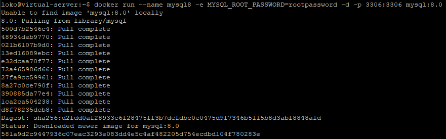

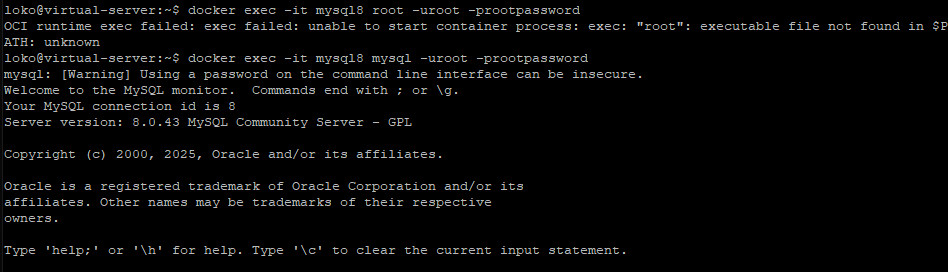

1.2

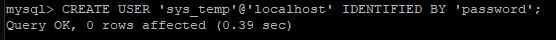

1.3

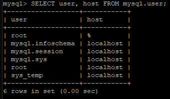

1.4

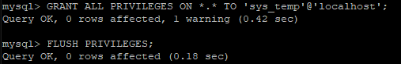

1.5

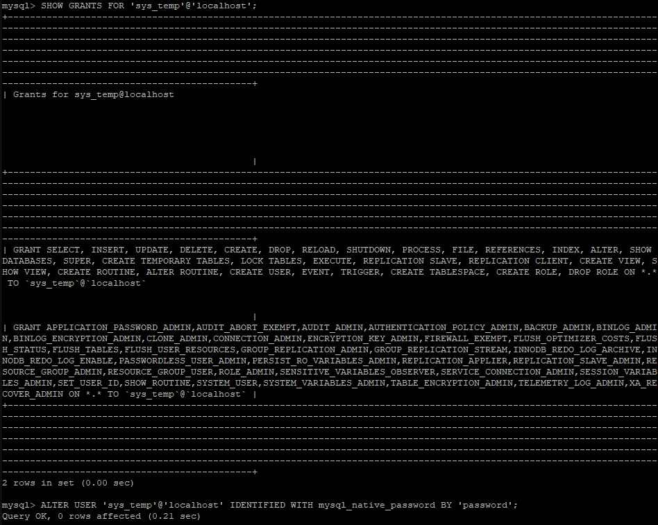

1.6

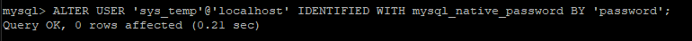

1.7

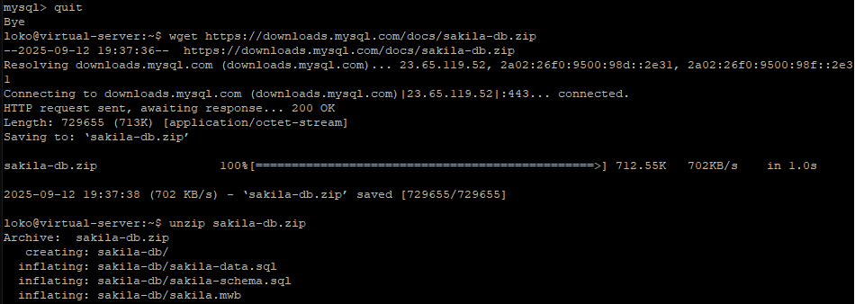

1.8

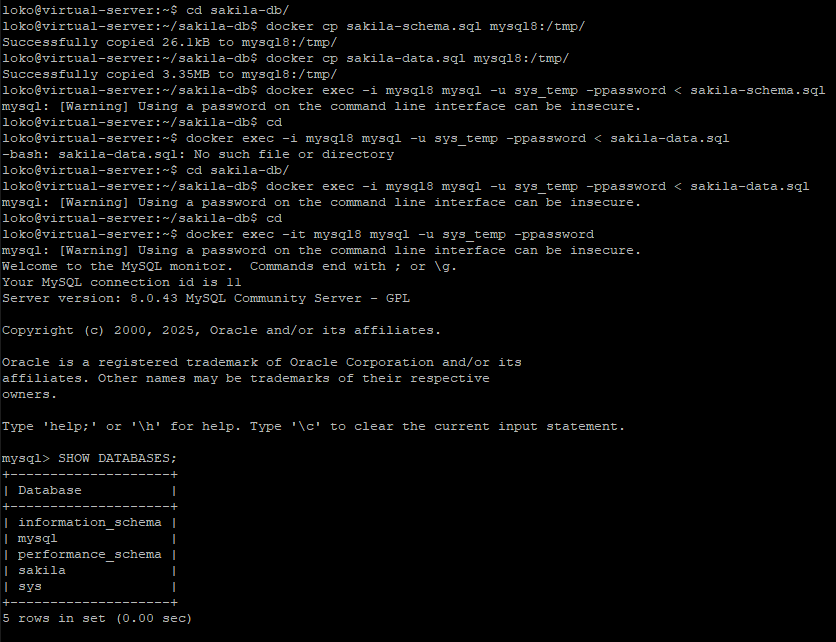

`Результат выполнения`

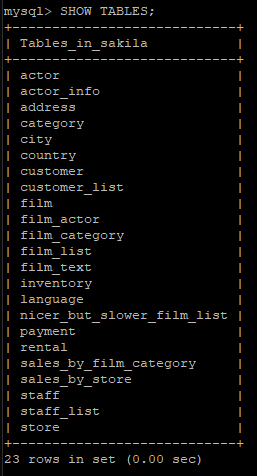

```
$docker run --name mysql8 -e MYSQL_ROOT_PASSWORD=rootpassword -d -p 3306:3306 mysql:8.0
$docker exec -it mysql8 mysql -uroot -prootpassword
>CREATE USER 'sys_temp'@'localhost' IDENTIFIED BY 'password';
>SELECT user, host FROM mysql.user;
>GRANT ALL PRIVILEGES ON *.* TO 'sys_temp'@'localhost';
>FLUSH PRIVILEGES;
>SHOW GRANTS FOR 'sys_temp'@'localhost';
>ALTER USER 'sys_temp'@'localhost' IDENTIFIED WITH mysql_native_password BY 'password';
>quit
$wget https://downloads.mysql.com/docs/sakila-db.zip
$unzip sakila-db.zip
$cd sakila-db
$docker cp sakila-schema.sql mysql8:/tmp/
$docker cp sakila-data.sql mysql8:/tmp/
$docker exec -i mysql8 mysql -u sys_temp -ppassword < sakila-schema.sql
$docker exec -i mysql8 mysql -u sys_temp -ppassword < sakila-data.sql
$cd
$docker exec -it mysql8 mysql -u sys_temp -ppassword
>SHOW DATABASES;
>USE sakila
>SHOW TABLES;
```

`При необходимости прикрепитe сюда скриншоты
`


---

### Задание 2

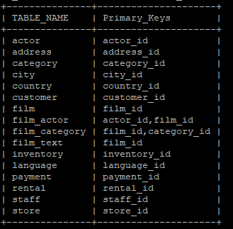

---
